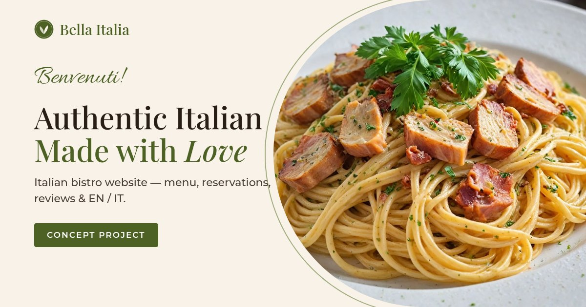

# Bella Italia — Italian Bistro Website

A concept website for a fictional Italian restaurant, built with plain **HTML, CSS and JavaScript** (no frameworks, no build step).



**Live demo:** [kinglant.github.io/bella-italia](https://kinglant.github.io/bella-italia/)

> This is a portfolio project. The restaurant, address, phone number, reviews and reservations are fictional — nothing is sent to a server.

## Features

- **Responsive layout** — desktop, tablet and phone
- **Full menu** with 6 categories (40 dishes), dietary tags (vegetarian, gluten-free, spicy, chef's pick) and animated tab switching
- **Table reservation form**
  - date and time slots generated from the opening hours (past times are hidden)
  - name and phone validation, US phone auto-formatting
  - loading state, confirmation popup with a booking code
  - **Add to Calendar** — downloads an `.ics` file
- **Guest reviews** slider with rating summary and a "Write a review" form (saved in the browser with `localStorage`)
- **Chef's specials** carousel with autoplay, arrows, dots and swipe
- **Gallery** with masonry-style grid and lightbox
- **Contact section** with embedded Google Map, directions link and today's opening hours highlighted
- **EN / IT language switch** — all texts, menu, time format (7:00 PM / 19:00) and dates; choice is remembered
- Scroll-reveal animations, sticky header, active-section highlighting, back-to-top button
- Live "Open now / Closed now" status
- Accessibility: semantic HTML, ARIA labels, keyboard support (Esc closes dialogs), `prefers-reduced-motion`
- Performance: WebP images (~2.3 MB total), lazy loading, image dimensions to avoid layout shift
- Favicon, Open Graph / Twitter preview image

## Project structure

```
index.html         page markup
style.css          all styles
script.js          interactions (sliders, forms, menu, gallery, language switch)
i18n.js            English / Italian translations
menu-data.js       menu items and prices
reviews-data.js    guest reviews
images/            WebP photos, favicon, social preview
```

To change the menu or reviews, edit `menu-data.js` or `reviews-data.js` — no HTML changes needed.

## Run locally

Just open `index.html` in a browser, or serve the folder:

```bash
python3 -m http.server 8000
# then open http://localhost:8000
```

## Credits

- Photos: [Pexels](https://www.pexels.com) (free to use)
- Fonts: [Playfair Display](https://fonts.google.com/specimen/Playfair+Display), [Montserrat](https://fonts.google.com/specimen/Montserrat), [Allura](https://fonts.google.com/specimen/Allura) — Google Fonts

---

Designed & developed by [Chill Coding](https://chillcoding.pythonanywhere.com).
